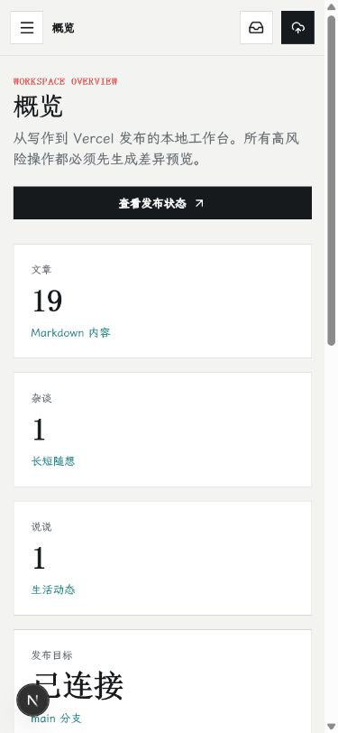

<div align="center">
  <h1>星辉云端</h1>
  <p><strong>YunYueBlogs 本地创作与发布控制台</strong></p>
  <p>把写作、图片、音乐、站点配置和 Git 发布放进一个安静的工作台，不必为每次更新手改源码。</p>
  <p>
    
    
    
    
  </p>
  <p>
    <a href="https://majo-elaina.top">查看博客</a> ·
    <a href="https://github.com/YunYueSama/YunYueBlog">公开站仓库</a> ·
    <a href="#第一次使用">安装教程</a>
  </p>
</div>


## 从创作到上线，只走一条路

星辉云端是 YunYueBlog 的本地管理端。它把内容和密钥留在你的电脑里，把经过确认的公开内容同步到 Astro 博客仓库，再通过 GitHub 交给 Vercel 部署。

> 本地工作区 → 差异预览 → Astro 博客仓库 → GitHub → Vercel

这里没有后台账号、在线数据库或远程 CMS。控制台只监听本机地址，文章草稿、图床 Token 和集成密钥不会随着管理端代码提交。

| 你可以完成 | 控制台会帮你处理 |
|---|---|
| 写文章、杂谈与说说 | 自动保存草稿、校验元数据、预览和失败恢复 |
| 管理头像、背景、封面、相册与正文图片 | 自定义图床、媒体清单、上传校验与统一选择器 |
| 维护项目、友链、外观和站点资料 | 结构化数据校验，不再改写组件源码 |
| 维护网易云与酷狗歌单 | 双源查询、可播放性检查、在线 KRC 逐字歌词与偏移校准 |
| 配置 Bangumi、Giscus 与 AI | 公共配置和本机密钥分离保存 |
| 更新本地仓库并发布 | 只允许 fast-forward，生成差异后再用中文提交推送 |

## 工作台预览

<table>
  <tr>
    <td width="72%">
      
      <p align="center"><sub>发布页：先预览受管文件差异，再同步、提交并触发 Vercel</sub></p>
    </td>
    <td width="28%">
      
      <p align="center"><sub>移动端：完整保留内容编辑与发布入口</sub></p>
    </td>
  </tr>
</table>

## 第一次使用

### 1. 准备环境

- Windows 10/11，桌面窗口模式体验最佳
- Node.js `22.12.0` 或更高版本
- Python `3.10` 或更高版本
- Git，以及可以访问 GitHub 的 SSH Key
- 一个已经创建好的 Vercel 账号

### 2. 把两个仓库放在一起

控制台仓库与公开博客仓库彼此独立。推荐使用下面的目录结构：

```text
YunYueBlogs/
├─ my-blog-manager/   # 星辉云端控制台
├─ YunYueBlog/        # 独立 Git 仓库，公开博客与 Vercel 部署源
└─ docs/
```

首次安装：

```powershell
git clone git@github.com:YunYueSama/YunYueBlogs.git
cd YunYueBlogs
git clone git@github.com:YunYueSama/YunYueBlog.git YunYueBlog
```

根仓库已经忽略 `YunYueBlog/`，因此两个仓库可以安全地并排更新和提交，不会形成嵌套仓库误提交。

### 3. 一键启动控制台

进入 `my-blog-manager`，双击 `Start.bat`；也可以在 PowerShell 中运行：

```powershell
cd my-blog-manager
.\Start.bat
```

首次启动会安装缺失依赖、构建 Next.js standalone 版本、启动随机空闲端口的 FastAPI 服务，并打开“星辉云端”桌面窗口。之后源码未变化时会直接复用现有构建。

### 4. 配置发布目标

打开左侧 **发布**：

1. 在“本地博客仓库”填写 `YunYueBlog` 的绝对路径。
2. Git Remote 保持 `origin`，目标分支通常填写 `main`。
3. Vercel 项目地址可以选填，它只用于快速查看部署状态。
4. 点击“检查状态”，确认分支、远程和工作区都正常。
5. 如果本地落后，可先“刷新远程”，再使用“安全更新本地”。更新只接受干净工作区的 fast-forward。

到这里，控制台已经可以把本机内容同步到公开博客仓库。

## 日常创作与发布

### 写作

从 **内容 → 新建内容** 选择文章、杂谈或说说。编辑器会自动保存草稿；标题、日期、标签、封面和摘要通过表单维护，正文支持 Markdown、表格、公式、代码块和图片。

保存操作进入持久化操作队列。你可以先继续编辑其他内容，再统一应用到本地 `workspace/`；刷新页面不会丢失待办操作。

### 发布

每次上线按这个顺序操作：

1. 在 **发布** 页面填写本次中文提交信息。
2. 点击“生成差异预览”，检查新增、修改、删除和警告。
3. 预览允许同步后，点击“应用同步”。控制台只写入受管目录。
4. 再点击“提交并推送”，等待 GitHub 推送完成。
5. GitHub 成功后，Vercel 仓库集成会自动开始构建。

如果公开博客仓库存在无关的未提交改动，预览会锁定发布并列出文件。控制台不会执行 `reset`、`clean`、自动合并、强制推送或递归覆盖未知目录。

> 在“集成”里点击保存，只代表配置已经进入管理端本地工作区。要让 Bangumi、Giscus、外观或音乐变更出现在博客中，还必须继续完成“差异预览 → 应用同步 → 提交并推送”。

## 常用功能怎么配

### 自定义图床与媒体库

1. 打开 **集成 → 自定义图床**，填写图床名称、上传接口和 Token。
2. 保存后点击“测试已保存配置”。Token 只写入本机 `workspace/config/secrets.json`，不会回显。
3. 前往 **媒体与图床** 上传图片或登记外链。
4. 在外观、文章、相册和友链页面中直接从媒体库选择资源。

上传接口限制单图 12 MB，并检查扩展名、MIME、图片魔数、尺寸和危险远程地址。首页关键主视觉建议保留在公开仓库，普通封面、相册和正文图片更适合走图床。

### 网易云与酷狗音乐

打开 **媒体与图床 → 音乐资源**：

- 网易云：粘贴歌曲详情页中的数字 ID；
- 酷狗：输入“歌曲名”或“歌曲名 + 歌手”，从搜索结果选择；
- 歌单最多 12 首，可以排序、删除并检查音源状态；
- 网易云歌曲会按歌名和歌手自动匹配酷狗 KRC，不需要上传歌词文件；
- 少量版本误差可以使用 `-5000` 到 `5000` 毫秒的单曲歌词偏移校准。

某首歌因版权或会员限制没有播放地址时，公开站会将它标记为不可用，不会把音源错误误报成浏览器自动播放限制。

### Bangumi 只读书架

在 **集成** 中填写公开 Bangumi 用户名并保存。同步发布后，博客 `/bangumi` 会读取想看、在看、看过、搁置与抛弃状态。该功能不需要 Token，也不会替用户写入收藏。

### Giscus 评论

1. 准备一个启用了 Discussions 的公开 GitHub 仓库。
2. 在 [giscus.app/zh-CN](https://giscus.app/zh-CN) 生成配置。
3. 将 Repository、Repository ID、Category 和 Category ID 填入 **集成 → Giscus 评论**。
4. 保存并完成一次发布。

本项目不再使用 Gitalk、OAuth App 或 `clientSecret`。未配置时公开站会明确显示评论暂未开放。

### AI 助手

控制台里的 Gemini Key 只供本机调试，不会自动上传。线上 AI 助手需要在 Vercel 项目中添加：

```dotenv
GEMINI_API_KEY=你的密钥
GEMINI_MODEL=gemini-2.5-flash-lite
```

保存环境变量后重新部署。`GEMINI_MODEL` 可省略。

## 本地数据在哪里

`my-blog-manager/workspace/` 会自动创建，并被 Git 忽略：

| 目录或文件 | 保存内容 |
|---|---|
| `content/`、`drafts/` | 文章、杂谈、说说和自动保存草稿 |
| `data/` | 项目、相册、友链与媒体清单 |
| `config/public.json` | 可以同步到公开博客的站点设置 |
| `config/integrations.json` | 非敏感连接信息 |
| `config/secrets.json` | 图床 Token、Gemini Key 等本机密钥 |
| `operations.json`、发布记录 | 操作队列和任务状态 |

备份控制台时，应单独备份 `workspace/`，但不要将其中的密钥文件上传到公开仓库、网盘分享链接或问题截图中。

## 开发模式

日常使用优先选择 `Start.bat`。需要调试前后端时，在 `my-blog-manager` 中安装依赖：

```powershell
npm ci
python -m pip install -r requirements.txt
```

先生成本地后端端口配置：

```powershell
node -e "require('fs').writeFileSync('public/backend_config.json', JSON.stringify({api_port:8000}))"
```

然后分别启动两个终端：

```powershell
# 终端 A
python -m uvicorn cms_core.main:app --host 127.0.0.1 --port 8000

# 终端 B
npm run dev
```

浏览器访问 `http://localhost:3000/admin`。

提交代码前执行：

```powershell
npm run lint
npm run typecheck
python -m pytest -q
npm run build
```

## 常见问题

| 现象 | 处理方式 |
|---|---|
| 配置保存了，博客仍显示“未配置” | 保存只写入 `workspace/`；前往发布页完成预览、同步和推送 |
| 生成差异后无法同步 | 按页面列出的脏文件处理公开博客仓库，控制台不会覆盖这些改动 |
| GitHub 推送失败 | 先在终端执行 `ssh -T git@github.com`，确认 SSH Key 和仓库写权限 |
| Vercel 没有自动部署 | 确认 Vercel 项目连接的是 `YunYueBlog` 仓库及正确分支，并检查构建日志 |
| 图床测试失败 | 检查上传 URL、Token、返回格式和网络；Token 留空保存会保持原值 |
| Bangumi 显示超时 | 用户名已同步但 `api.bgm.tv` 当前不可达，和“未配置”是不同状态 |

更深入的设计和故障说明见 [博客 2.0 项目总览](docs/博客2.0项目总览.md)、[部署与运维指南](docs/部署与运维指南.md)与 [技术笔记索引](docs/README.md)。

## 致谢与许可

YunYueBlogs 基于 [XinghuisamaBlogs](https://github.com/heiehiehi/XinghuisamaBlogs) 持续演进，感谢原作者的开源贡献。本次 2.0 重构重新设计了公开站、管理工作台、内容契约与发布链路。

项目采用 [CC BY-NC 4.0](LICENSE) 许可。允许学习、分享和注明来源的非商业二次创作；商业使用请先取得授权。
