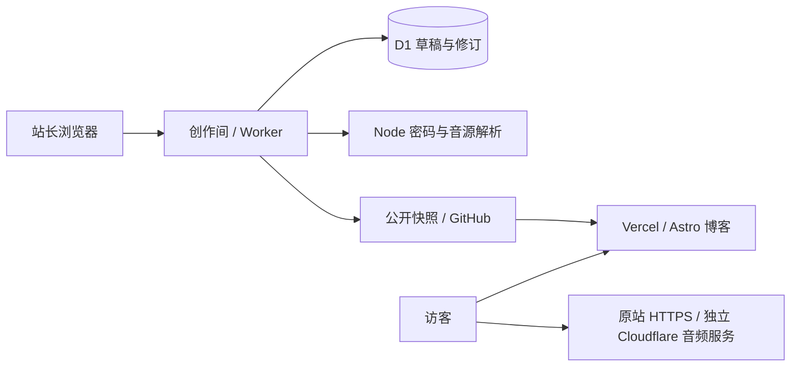

<div align="center">

# 云月的创作间 · YunYueBlogs

**把日常写成文字，把喜欢留在自己的站点。**

[逛逛博客](https://yunyuesama.cn) · [公开博客源码](https://github.com/YunYueSama/YunYueBlog) · [English](README_en.md)

</div>

这是我的个人博客配套创作系统，也分享给喜欢折腾个人网站的朋友。浏览器里写作、管理歌单和图片，发布后交给静态博客展示；换一台电脑或拿起手机，也能继续编辑。

公开站与创作间有各自的界面：博客强调阅读、音乐和角色场景，控制台围绕文稿与配置组织工作。两边通过公开快照连接，私密草稿和集成密钥留在服务端。

## 可以做什么

- **在线写作**：单站长账号、首次改密、Markdown 预览、自动保存、修订冲突提示、断网草稿恢复与导出。
- **整理自己的小站**：文章与生活动态、相册、作品、友链、站点外观、Bangumi ACG 书架。
- **收藏音乐**：自定义 LX 兼容音源、五渠道关键词检索、歌单排序、自动歌词、右侧试听播放器；音质由站长统一配置。
- **图片管理**：连接自己的公开图床、上传记录、编辑器选图；私有 R2 素材为可选功能。
- **明确的发布状态**：草稿保存后可继续修改，正式发布生成不可变公开快照，由 GitHub / Vercel 构建，正式站核验通过后显示上线。
- **轻盈的交互**：局部玻璃、场景视差、原生 View Transition 与短时淡入；小屏和减少动态效果偏好有对应处理。

## 仓库怎么分

| 位置 | 职责 |
| --- | --- |
| [YunYueBlog](https://github.com/YunYueSama/YunYueBlog)（独立仓库） | Astro 7 / React 19 公开站，静态页面与少量动态 API |
| [`apps/console`](apps/console) | React / Vite 创作间，Cloudflare Worker API 与 D1 |
| [`apps/console/music-worker`](apps/console/music-worker) | 独立 Cloudflare 音频传输服务 |
| [`services/password-verifier`](services/password-verifier) | Node scrypt 与隔离的音乐脚本解析，可部署于 Vercel |
| [`my-blog-manager`](my-blog-manager) | 保留的旧版 Windows 本地管理端（Next.js / FastAPI） |
| [`docs`](docs/README.md) | 自建、架构与设计资料 |



## 自己搭一个

先 Fork 本仓库与公开博客仓库，准备符合各 `package.json` engines 的 Node.js、Git、Cloudflare 和 Vercel 账号。控制台使用 `cf` CLI；请先登录自己的账号，核对免费额度。

```powershell
# 在本仓库中运行；公开站是第二个独立 Git 仓库
 git clone https://github.com/<your-name>/YunYueBlog.git YunYueBlog
 cd apps/console
 npm.cmd ci
 npm.cmd test
 npm.cmd run build
```

正式接入顺序是：**Node 服务 → D1 与初始化账号 → 音频 Worker → 创作间 → 公开博客环境变量 → 实际页面验收**。域名、仓库名和绑定名称需要换成自己的，不能直接复用作者的生产配置。

完整步骤见[部署与运维指南](docs/部署与运维指南.md)，各服务的变量和限制见[控制台说明](apps/console/README.md)、[Node 服务说明](services/password-verifier/README.md)。没有默认共享账号；初始化脚本从私有进程环境读取账号与密码，生成一次性激活票据，第一次登录必须改密。

日常使用：在自己的管理域名登录 → 编辑并保存 → 检查选入公开快照的内容 → 发布 → 等待正式站核验。**保存草稿不会立即改动公开站**。初始化后也可以继续通过 Git 编辑公开仓库；多人同时维护时，发布前请核对云端文稿与仓库差异。

## 音乐与费用

音乐搜索支持音源声明的网易云、酷狗、QQ、酷我、咪咕渠道。导入脚本后先测试再启用；第三方音源的可用性、版权和渠道规则由相应提供方决定，不保证每首歌、每种音质都可用。项目不附带第三方音源文件、平台 Cookie 或付费内容。

Vercel 只处理公开页面、少量 JSON 与 Node 解析，音频正文优先原站 HTTPS 直连，需要时走独立 Cloudflare 服务。HTTPS 地址通过正常证书验证，不通过关闭 TLS 校验处理失败。

**绕开 Vercel 不等于没有成本。** Cloudflare Workers 有请求数、CPU 等限制，中转还有服务条款及上游限速；无损会增加访客流量和缓冲时间。默认 320 kbps，支持站长选择无损及兼容回退；可设置滚动 31 日中转预算。平台额度会变，以自己的控制台与官方最新说明为准，不把某个固定额度写成所有套餐的承诺。R2 私有素材默认不创建、不绑定，需要时单独开通。

Robin 聊天使用服务端 DeepSeek API Key，计费独立于网站流量；没有配置时不影响静态阅读与本地小考。

## 开发与贡献

欢迎分享体验、提交问题或提出小功能。提 Issue 时附复现步骤、浏览器与去除隐私后的截图；PR 请说明改动目的和实际验证。

```powershell
# 创作间
cd apps/console
npm.cmd run typecheck
npm.cmd test
npm.cmd run build

# Node 服务
cd ../../services/password-verifier
npm.cmd ci
npm.cmd test

# 公开博客（独立仓库）
cd ../../YunYueBlog
npm.cmd ci
npm.cmd test
npm.cmd run build
```

本机凭据、数据库、草稿备份、`.env`、`.cloudflare` 和 `.vercel` 不进入仓库。示例环境文件只放空值；公开内容、运行素材和许可证需要保留。

## 参考与许可

感谢 [spring_blogs](https://github.com/RRTiamo/spring_blogs)、[QWidgetSekai](https://github.com/Aegisir/QWidgetSekai) 提供产品与交互思路；Web 界面按本项目技术栈独立实现。LX 音源接口适配参考 [lx-music-desktop](https://github.com/lyswhut/lx-music-desktop)，相关适配代码出处与 Apache-2.0 文本见[第三方声明](services/password-verifier/THIRD_PARTY_NOTICES.md)。

仓库自有内容遵循 [CC BY-NC 4.0](LICENSE)。第三方代码、字体、图片、角色与游戏素材各自适用原许可；《魔法使之夜》相关权利属于 TYPE-MOON 及相关权利人，仓库许可不代表取得这些素材的再授权。自建和再分发前请替换个人内容、确认素材使用权限。
