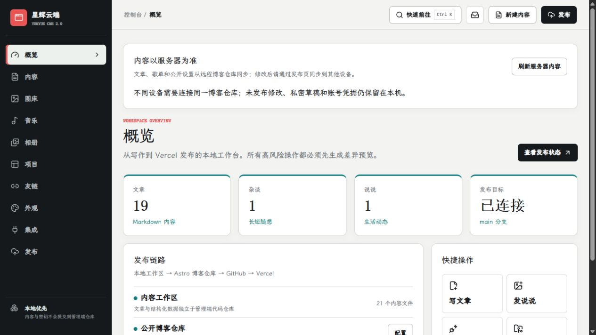
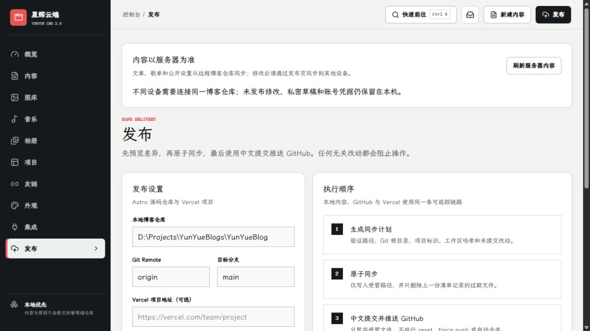

# YunYueBlogs · Local Blog Console

**Ai·Code·Magic** — a Windows desktop console for writing, media, music and reviewed publishing.

[中文文档](README.md) · [Live blog](https://majo-elaina.top) · [Public blog repository](https://github.com/YunYueSama/YunYueBlog)



This repository contains the Next.js 16 / React 19 interface and FastAPI backend in `my-blog-manager`. The public Astro 7 blog lives in a separate repository.

## Start on Windows

Requires Node.js 22.12+, Python 3.10+ and Git.

```powershell
cd my-blog-manager
npm.cmd ci
python -m pip install -r requirements.txt
.\Start.bat
```

## Data and publishing

The connected remote blog repository is the shared source for public content. Connect every device to the same repository and refresh server content before editing. Drafts, account credentials and unpublished changes remain local.

Save locally → review the publishing diff → apply the sync → commit and push → verify the Vercel deployment. Article Giscus/Gitalk comments have been removed; music comments remain available.



Local workspace data, credentials, dependencies and generated builds are excluded from Git. Put production API keys in Vercel environment variables, never in public JSON or screenshots. Removing a tracked file does not remove past commits; rotate any previously exposed real credentials.

See the [Chinese operations guide](docs/部署与运维指南.md) for development, checks and recovery. Game artwork and character references retain their original owners' rights; verify asset permissions before reuse.
