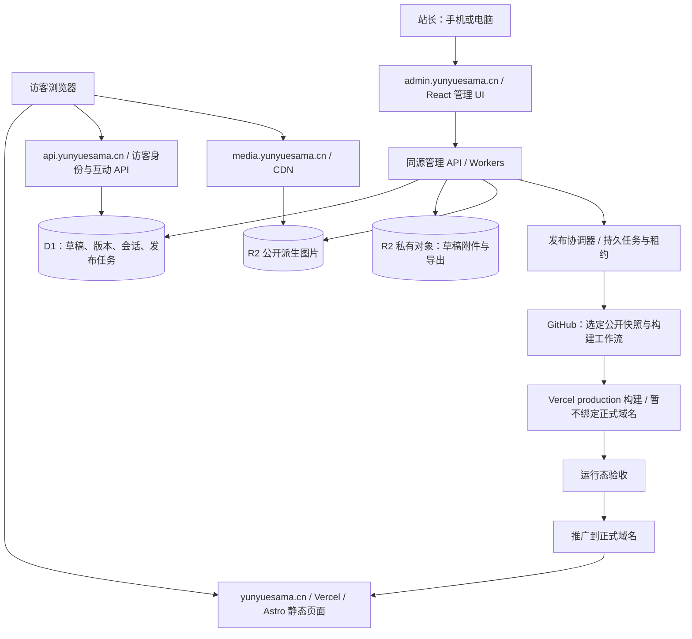
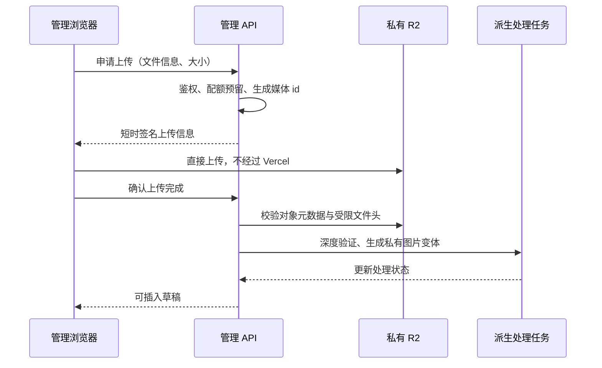

# YunYueBlogs 3.0：全面重构与云端管理方案

> 版本：实施修订 v1.1
>
> 调研日期：2026-11-02（Asia/Shanghai）
>
> 对象：公开博客、线上管理端、账号与互动、内容发布、媒体、音乐、Robin、部署与费用控制
>
> 本文为设计路线与阶段规划，包含后续功能设想；实际实现和部署范围以[实施记录](博客3.0实施与验收记录.md)与当前 README 为准。

## 1. 建议先确定的结论

建议采用 **Astro 静态公开站 + React 云端管理端 + Cloudflare Workers API + D1/R2 持久化 + GitHub/Vercel 版本化发布**。

公开站继续部署在 Vercel，正文、导航、相册说明、作品和公开配置以静态快照提供。管理端从“本机文件管理工具”改成“登录后使用的线上内容系统”；草稿、账号、互动和发布任务存放在云端，关闭电脑后仍然可用。大图片、原图和上传文件不通过 Vercel Function 中转。

视觉定位是 **具有角色气质的个人内容馆**：保留 YunYueSama、《魔法使之夜》角色主题、音乐陪伴和 Robin 的辨识度，重新组织页面、组件和动效。文章阅读与管理操作保持清晰，角色表现集中在有意义的位置。

不直接照搬参考项目的 Next.js + Vue + Spring Boot + MySQL 全栈。它证明了线上管理的交互形式，但它的运维前提和本项目的免费额度目标不同。

### 1.1 用户已经确定的取舍

| 问题 | 已确认选择 | 对方案的影响 |
| --- | --- | --- |
| 账号服务对象 | 单站模式，唯一站长；访客可以登录互动；不开放公众建站 | 不建设租户、套餐、站点创建和团队权限平台 |
| 费用 | 优先零费用，允许限制媒体、AI、访问量；保留付费扩容选项 | 把预算、限流和降级纳入基础设计 |
| 品牌 | 保留角色与个人品牌，重做布局、动效、组件系统 | 不改成与现有身份无关的通用博客模板 |
| 发布速度 | 保存草稿立即完成，正式发布接受约 1–3 分钟构建 | 采用静态发布，避免每次阅读都查询数据库 |
| 域名 | 全部使用 yunyuesama.cn；此前已要求移除旧域名及兼容配置 | 不恢复旧域名绑定、解析、别名或跳转 |

**尚待单独确认的产品项：音乐平台账号能力的保留程度。** 本稿默认推荐“保留播放器、歌单与歌词体验；不可合法直连或账号失效时提示并跳转平台”。如果要求所有音乐账号能力完全云端可用，需要独立验证，可能增加费用。它不阻塞内容后台和公开站重构。

### 1.2 优先级

1. 内容、私密草稿和账号安全。
2. 云端可用、发布可靠、迁移可恢复。
3. 阅读与管理流程便捷。
4. 视觉、动效、角色体验。
5. 在预算之内增加互动、AI 和创新功能。

这些目标必须同时落到验收标准上。“最新框架”“更多动画”“全站实时”本身不算完成标准。

## 2. 参考项目：借鉴什么，调整什么

### 2.1 实际核验范围

参考来源：

- 博客前台：[RRTiamo/spring_blogs](https://github.com/RRTiamo/spring_blogs)，调研提交 a57b66189c14c80f75920960028768a6edd0926b。
- 管理后台：[RRTiamo/spring_admin](https://github.com/RRTiamo/spring_admin)，调研提交 b8d9adcb17da49e13273d3ac9f72fa2ba777def1。
- 服务端：[RRTiamo/spring_server](https://github.com/RRTiamo/spring_server)，调研提交 f1dd264a3366a65f4e5d80fe297adf985294db22。
- [Bilibili 演示视频 BV19vT76ZESt](https://www.bilibili.com/video/BV19vT76ZESt/)，时长 9 分 26 秒。

已读取三仓库 README、前后台依赖、前台首页与 API 配置、管理端路由/请求层、服务端鉴权配置等。首轮观察平台关键帧；实施阶段又通过视频原生播放跳转提取 98 帧，并逐张查看覆盖全片的 9 张联系表，覆盖前台与后台关键流程。没有逐秒观看或完整核验音轨，平台未返回可用字幕。

三个参考仓库的 README 均声明尚未附带开源许可证。**借鉴产品组织与交互思路，独立实现代码和视觉资产；直接复用任何代码或素材前，另行确认许可。** 不复制作者的照片、私人生活数据、地图坐标或默认内容。

### 2.2 参考项目的真实技术结构

| 部分 | 核验到的实现 | 对本项目的启发 |
| --- | --- | --- |
| 前台 | Next.js 16、React 19、GSAP、Lenis、Framer Motion；API 数据驱动 | 生活内容可以形成统一浏览体验 |
| 后台 | Vue 3、Vite、Naive UI、侧栏管理、登录路由 | 线上后台需要清晰的信息架构和完整工作流 |
| 后端 | Spring Boot、MySQL、Sa-Token、存储适配 | 真正持久的数据与鉴权必须放在服务端 |
| 部署 | 独立后端；前端同源 /api 转发到服务端 | 不能仅把本地 Next.js 页面上传就称为线上 CMS |
| 内容表达 | 文章、相册、近况、便签、足迹、成就等 | 按内容类型组织，而不是把所有内容塞进一张列表 |
| 视觉 | 大主视觉、柔和底色、卡片层次、主题配置、角色装饰 | 建立整站视觉语法，而不是只改首页 |

视频关键帧观察：约 0:00 为首页主视觉，0:20 为文章入口，2:10 为便签；3:14 为后台登录，3:27 为后台仪表盘，3:56–4:11 涉及照片与内容管理，后半段展示主题、页面、配置和文件管理。上述时间仅用作观察线索，不代表已经验收这些功能。

### 2.3 采纳与调整

| 参考思路 | 本项目建议 | 原因 |
| --- | --- | --- |
| 统一线上内容后台 | 采纳 | 满足手机、平板、异地电脑管理 |
| 首屏人物主视觉与生活气息 | 采纳并重设计 | 保留个人辨识度 |
| 主题化页面与配置预览 | 采纳 | 让作者可维护主题，不依赖改代码 |
| 文章/影像/近况分开管理 | 采纳 | 内容模型明确，发布更容易校验 |
| 大量横向锁定滚动 | 只在可选展示区使用 | 正文、移动端和键盘使用不应依赖滚动特效 |
| GSAP + Lenis + Motion 同时覆盖全站 | 不作为默认组合 | 避免重复动画系统、滚动冲突和额外脚本 |
| 所有页面实时请求服务端 | 改为静态快照 + 独立互动 API | 降低源站传输与服务故障影响 |
| 管理 Token 放 localStorage | 不沿用，改为服务端会话 + HttpOnly Cookie | 降低脚本读取长期会话凭据的风险 |
| 环境变量式固定管理员密码 | 按用户要求采用账号密码、强制初始改密与服务端会话 | 密码采用带盐 scrypt，不以公开前端配置鉴权 |
| 恋爱日记、时间信箱、地图等全部照搬 | 仅保留有实际使用目的的模块 | 避免制造空页面和额外隐私负担 |

这里的实现差异用于本项目选型，不是对参考项目的完整安全审计。

## 3. 当前项目基线与必须保留的能力

### 3.1 当前架构

```text
Next.js 16 管理界面
    -> 本机 FastAPI
    -> workspace 中的内容、草稿、配置、密钥
    -> Git 同步计划/应用/推送
    -> 独立公开博客仓库
    -> GitHub main
    -> Vercel：Astro 7 静态页面 + 动态 API
```

当前管理端不是可以直接部署到公网的账号系统：

- workspaceData.ts 直接读取文件系统和本机 backend_config.json。
- managerApi.ts 调用本机服务。
- FastAPI 原有信任边界以本机窗口、Origin 和本机工作区为中心。
- Git 发布、登录文件、音乐服务和后台任务依赖本机进程。
- “Git 远程内容同步”不等于“电脑关机后仍可用的线上管理服务”。

因此不能只加一个登录页面、放开 CORS、把监听地址改为 0.0.0.0 就上线。

### 3.2 本次核验到的规模

| 项目 | 本次观察 | 解释 |
| --- | --- | --- |
| 内容文件 | 19 篇文章、1 篇杂谈、1 条说说、1 个关于页面文件 | 文件数量，不等于按访问量统计 |
| 主站 | Astro 7、React 19 Islands、Tailwind 4、Pagefind | 适合继续发挥静态内容优势 |
| 管理端 | Next.js 16、React 19、TipTap、FastAPI | UI 和编辑器可复用，文件/端口/Git 层需替换 |
| 当前首页 | HTTP 200；HTML 解压后约 70,516 字节；canonical 指向新域名 | 不把 HTML 大小当作完整首屏流量 |
| 本地字体资产 | 183 个文件，合计约 12.58 MiB | 资源总量，不代表单次访问全部下载 |
| 本地图片资产 | 245 个文件，合计约 10.40 MiB | 含多尺寸版本；需按实际请求分析 |
| 当前构建产物 | 主布局 CSS 约 212 KB，部分 JS 单文件约 134–181 KB，均为未压缩文件大小 | 用作拆分线索，不冒充线上压缩传输量 |
| 浏览器性能 | 尚未重新取得本次完整移动端瀑布图和 Web Vitals | 不引用旧审查的 TTFB/FCP 作为新基准 |
| Vercel 当前用量 | CLI 未返回可用的近 30 天账单用量 | 不能推断使用量为零，实施前须补控制台证据 |

### 3.3 功能迁移表

| 当前能力 | 3.0 去向 | 必须保留/补足的行为 |
| --- | --- | --- |
| 首页、归档、标签、Markdown 正文 | Astro 静态内容站 | 旧内容 slug、标题、日期、目录、代码、公式完整 |
| 杂谈、说说、项目、相册、友链、关于 | 统一内容模型 + 各自展示模板 | 不把不同内容强制合成一种文章 |
| 青子/有珠/草十郎主题 | 新设计系统 | 主题选择、阅读对比度、切换中断处理 |
| 全站音乐与逐字歌词 | 共享播放器 + 音乐适配层 | 单音频实例、切页不中断、源失败有提示 |
| Robin | 独立延迟加载模块 | 先保证导航和固定能力，再按预算开放 AI |
| Bangumi 书架 | 静态快照为主、显式刷新 | 上游超时不阻止页面阅读 |
| 阅读收藏 | 匿名本机使用 + 登录后的可选云同步 | 不因登录强制清空既有收藏 |
| 内容编辑、草稿、预览 | 云端 CMS | 自动保存、冲突检测、跨设备恢复 |
| 媒体库与图床 | 媒体记录 + 对象存储 | 私密草稿附件与公开图片分开 |
| Git 同步与发布任务 | 云端发布协调器 | 队列、重试、版本、发布证据 |
| 本机音乐账号与服务 | 单独适配与验证 | 不能承诺原本依赖本机的能力原样可用 |
| Windows 安装器/桌面壳 | 正式云端切换后退出主流程 | 日常操作不要求安装 Node/Python/Git |

当前 /tree、/timeline 是指向 /projects、/archive 的站内跳转。3.0 是否将其发展成独立内容页应由实际内容决定，不计作已经存在的成熟模块。此前已移除的文章第三方评论，也不能误报为现成的登录互动系统。

## 4. grilling：已经追问的假设与压力测试

### 4.1 已通过用户回答收敛的决定

- “账号系统是否意味着做一个多租户建站平台？”——否，只服务单站与访客。
- “为了完整能力是否默认接受月费？”——否，零费用优先，允许降级。
- “全面重构是否允许丢掉角色身份？”——否，保留身份、重做表达。
- “发布是否必须秒级？”——否，草稿即时保存，公开发布允许等待构建。

这些回答将需求从“复制三端平台”收敛到“个人内容站 + 云端创作控制台”。

### 4.2 必须用反例检验的设计

| 质询/反例 | 本方案的回答 | 对应验收 |
| --- | --- | --- |
| Cloudflare API 暂时故障，公开文章还能看吗？ | 已发布页面独立静态托管；互动模块局部提示不可用 | 阻断 API 后，正文、导航、搜索仍可用 |
| 电脑关机后，手机保存的内容在哪里？ | 云端 D1/R2，不依赖本机 workspace | 关闭电脑，在真实手机登录、编辑、重新登录后仍能读到 |
| 两台设备同时编辑同一篇文章，后保存的人会覆盖前者吗？ | 使用版本号与条件更新；冲突返回 409 | 双设备旧版本保存被拒绝并提供对比 |
| 草稿里有照片，它会被搜索引擎或静态部署拿到吗？ | 草稿和附件留在私有存储；发布导出只取选定版本 | 未登录抓取、站点地图、搜索索引、构建产物均无草稿 |
| 用户按了发布，Vercel 只是收到请求，后台能显示成功吗？ | 不能；要等构建、推广和新域名运行态核验 | 受理、构建、正式上线分别显示 |
| GitHub 或 Vercel 暂时不可用，会不会丢稿？ | 保存不依赖发布平台，任务可重试 | 平台故障注入后，草稿完整且旧站继续可读 |
| 靠 CDN 能保证永远不超过免费额度吗？ | 不能；缓存失效、冷访问、API 和重试仍有成本 | 预算按未命中与高峰场景计算 |
| 把音频代理搬到 Worker 是否就无限免费？ | 不能；仍有请求/CPU/服务条款与源站限制 | 不把 Worker 当作无限媒体隧道 |
| 一个公开访客登录后能不能访问站长接口？ | 不能；身份与站长授权分离 | 全部管理写接口有服务端拒绝用例 |
| 加入高级动效后，慢手机和减少动态效果用户怎么办？ | 原生滚动、静态可读、可关闭动态层 | 低端机、键盘和 reduced-motion 均单独验收 |
| 要是 OAuth 账号丢失，唯一站长还能恢复吗？ | 有独立的部署控制台恢复流程，审计记录身份变更 | 演练恢复，不提供公众“认领站长”入口 |
| 回滚代码是否会自动回滚草稿数据库？ | 不会；代码、数据库、公开快照分别恢复 | 在演练中恢复指定公开版本且不覆盖新草稿 |
| 0 费用是否等于未来任何流量都免费？ | 否；限定使用规模并在额度前降级 | 面板显示来源、时间、阈值和可用状态 |

### 4.3 当前仍需原型验证的事项

1. Workers Free 每次调用 10 ms CPU 下，认证、正文校验和当前第三方 SDK 是否能稳定运行。
2. 当前音乐适配层在云端的兼容性、账号安全和跨地区可用性。
3. 中国大陆常用网络访问 Vercel、Cloudflare、OAuth 与对象存储的实际延迟。
4. R2 是否已经启用、免费额度还剩多少、账号的付费/超额设置。
5. 当前 Vercel 源站流量的接口、地区、缓存命中分布。

这些事项是实施前的通过条件，不用“理论上可行”替代结果。失败时按第 15 节的替代路线处理。

## 5. 架构选择

### 5.1 方案比较

| 选项 | 优点 | 主要代价 | 结论 |
| --- | --- | --- | --- |
| 维持本机管理，只美化页面 | 改动小 | 不满足线上管理 | 排除 |
| 公开站与后台都改成 Next.js SSR，集中放 Vercel | 单框架，生态成熟 | 动态正文、媒体中转、认证都集中消耗 Vercel 资源；本机层仍需重写 | 不作为默认 |
| 完整采用参考项目三端技术结构 | 概念成熟，长期服务兼容性强 | 常驻 Java 服务、MySQL、对象存储与运维，不符合零费用优先 | 付费备选 |
| Astro + 云端静态管理 UI + Workers/D1/R2 | 保留公开站优势；日常管理云端化；媒体独立 | 新增云端 API 与发布协调，必须验证运行时 | **推荐** |
| 全部迁到 Cloudflare，包含公开站 | 静态资源免费空间更大，平台更集中 | 同时更换公开站托管，扩大首轮迁移范围；现有服务端 SDK 仍需适配 | Vercel 后续无法满足时的独立选项 |

### 5.2 推荐结构



推荐保留两个清晰代码边界：

- **YunYueBlog**：公开站源码、公开内容快照、公开配置、公开资产引用、静态发布构建。
- **YunYueBlogs**：云端管理 UI、管理/互动 API、契约、导入导出、运维工具。

现有 Git 仓库已经独立，第一阶段不强行合并历史。云端控制台内部可采用 apps/console、apps/admin-api、apps/public-api 与 packages/contracts、packages/content、packages/design-tokens 等目录；是否使用 workspace 管理工具在实现时按依赖数量决定，不把工具替换列成业务成果。

管理 UI 默认由 Workers Static Assets 托管 React + Vite 构建结果；仅管理 API、登录回调等指定路由执行 Worker。静态应用壳可以公开下载，其中不包含草稿、密钥或会话；真正的数据权限始终由 API 验证。不能为了隐藏菜单，让全部 JS/CSS 都经过动态鉴权。

### 5.3 域名与流量边界

| 域名 | 用途 | 要求 |
| --- | --- | --- |
| yunyuesama.cn | 主站 | 静态公开页面，稳定 canonical |
| www.yunyuesama.cn | 新域名的 www 入口 | 统一跳转到主站 |
| admin.yunyuesama.cn | 站长后台、同源管理 API、站长登录回调 | 与访客会话隔离 |
| api.yunyuesama.cn | 访客登录、评论/收藏同步、必要的动态小响应 | 严格来源、会话、限流 |
| media.yunyuesama.cn | 新媒体资产 CDN | 内容哈希路径、长缓存，不暴露私有桶 |
| tu.yunyuesama.cn | 当前图床 | 先核实真实存储渠道，再迁移内容；完成后按清单退出旧图床服务 |

tu.yunyuesama.cn 已经是新域名下的现有服务；它的存储不能仅凭 Worker/KV 配置推断为 R2。迁移过程不恢复任何旧顶级域名。

公开站如访问 Cloudflare API，浏览器直接请求指定 API 域名。不要为了表面“同源”把所有流量先经过 Vercel rewrite 再中转，这仍会引入平台请求和传输开销。

## 6. 云端账号与权限

### 6.1 最小角色模型

| 角色 | 能做什么 |
| --- | --- |
| 未登录访客 | 阅读、搜索、浏览公开作品/相册，按策略使用公开音乐与 Robin 固定能力 |
| 登录访客 | 收藏同步、提交评论/留言、查看和管理本人允许修改的互动 |
| 唯一站长 | 管理内容、审核互动、发布、配置集成、查看预算与审计 |
| 云端发布服务 | 只读取指定发布快照、更新受管公开路径、查询/推广对应部署 |

不为第一版添加团队、租户、订阅、计费、任意角色编辑器。

### 6.2 站长与访客登录方式

站长按用户后续要求采用账号密码登录。账号初始化通过私有批次完成，24 小时一次性激活票据只交给站长，首次登录必须改密后才能访问内容、素材和发布接口。新密码采用独立 Node 服务的固定强度 scrypt；Worker 负责 D1 会话、限流、Origin 与 CSRF 校验，避免为了适应免费 Worker 的 CPU 限制降低密码哈希强度。恢复通过受控服务端操作，不能开放公众认领入口。

访客账号仍是后续阶段，可单独验证 GitHub OAuth：

- 站长身份绑定不可变的 provider user id，不以可修改的昵称判定。
- 访客登录与站长登录使用明确区分的回调与会话用途。
- 站长名单通过受控部署配置建立，普通注册永远不能申请或自动取得站长权限。
- 访客登录只获取必要的基础身份，不申请仓库写权限。
- 若目标访客普遍无法顺畅使用 GitHub，再评估托管身份服务或邮件验证码；不默认引入短信费用。
- OAuth 回调校验 state，并在提供方支持的流程中使用 PKCE；回跳地址采用固定白名单。

站长密码登录已替代本稿早期的 OAuth 默认建议。访客登录与站长权限保持分离，不能因为登录第三方账号自动取得管理权。

### 6.3 会话与请求

- 使用随机、不透明的会话 id；服务端只存会话摘要、到期时间和身份关系。
- 使用 Secure、HttpOnly、Path=/ 的 host-only Cookie；条件满足时采用 __Host- 前缀。
- 站长和访客 Cookie 分别作用于管理域与 API 域，不设置宽泛的 Domain=.yunyuesama.cn。
- 站长会话建议闲置 30 分钟失效，最长 12 小时；敏感操作要求近期重新认证。
- 访客会话可更长，但必须支持主动退出、注销和服务端撤销。
- 跨域访客请求只允许主站准确 Origin，携带凭据时禁止 CORS 星号；写请求再校验 CSRF。
- 不把路由守卫、隐藏菜单、CORS 或 robots.txt 当作鉴权。
- 所有管理读取与写入都在 API 层校验站长身份；访客修改条件同时绑定当前用户与资源。
- Cookie、OAuth code、私钥、音乐账号信息和签名上传地址不进入日志、统计或公开仓库。
- 开发/预览环境不自动获得生产会话或生产数据库权限。

### 6.4 账号恢复

提供一套经过演练的站长恢复流程：使用独立的 Cloudflare/GitHub 管理权限核实身份，撤销旧站长会话，更新绑定，记录审计。恢复密钥离线保管，不放浏览器 localStorage。禁止设置“第一个注册者即站长”的公网初始化入口。

## 7. 内容、草稿、互动和媒体数据

### 7.1 数据职责

| 数据 | 存放位置 | 能否进入公开 Git 仓库 |
| --- | --- | --- |
| 用户、外部身份映射、会话 | D1 | 否 |
| 草稿、自动保存、修订记录 | D1；大型导出放私有 R2 | 否 |
| 已选定发布的 Markdown 与公开配置 | 不可变发布快照 + GitHub | 是，仅公开投影 |
| 私密附件原始文件 | 私有 R2 | 否 |
| 已确认公开的图片变体 | 公开 R2/CDN | 只保存 URL、尺寸和媒体 id |
| 评论、留言、收藏关系 | D1 | 不批量导出私人数据 |
| 密钥 | Workers Secrets / CI Secrets | 否 |
| 发布任务与审计 | D1 | 否 |
| 公开检索索引 | 构建期 Pagefind | 只含已公开内容 |

数据库是编辑与互动的事实来源；GitHub 是公开发布的可复现记录。两者不能互相覆盖草稿。日常编辑不使用 Git pull、Git push 作为数据保存 API。

### 7.2 建议的核心表

| 表 | 主要字段/约束 |
| --- | --- |
| users | id、状态、展示名；不把展示名用于授权 |
| identities | provider、provider_subject、user_id；前两项唯一 |
| sessions | token_hash、user_id、用途、过期时间、撤销状态 |
| documents | id、type、slug、当前 draft_revision、published_revision、状态 |
| document_revisions | document_id、revision、正文、元数据、作者、时间；修订不可变 |
| settings_revisions | 配置命名空间、版本、公开投影 |
| media | id、私有 object_key、公开派生 key、MIME、尺寸、哈希、状态 |
| media_references | 媒体与文档/版本关系；清理前查引用 |
| releases | release_id、快照摘要、内容版本、Git commit、deployment_id、状态 |
| jobs/outbox | 类型、幂等键、租约、次数、下一次重试、错误摘要 |
| comments | 用户、目标内容、正文、审核状态、创建/编辑时间 |
| bookmarks | 用户、内容 id；组合唯一 |
| audit_events | 操作人、动作、对象、结果、时间；不存凭据正文 |
| quota_counters | 日期桶、资源类型、保守预留量、状态 |

第一版按单站设计，不提前为所有表堆 tenant_id。为以后迁移保留稳定内容 id 和导出格式即可。

D1 Free 当前是每账号总计 5GB，但单数据库最大 500MB。数据库不能当图片库或无限历史仓库。设置修订保留数量、审计保留周期和清理任务；“无限自动保存历史”不进入默认承诺。

### 7.3 文档格式与编辑器

保留 Markdown 作为文章正文的可导出规范，复用 TipTap 编辑经验：

- 明确正文与编辑器缓存的唯一事实来源，避免 Markdown/编辑器 JSON 双向保存后各自变更。
- 标题、slug、标签、封面、摘要、可见性、日期作为独立结构化字段。
- 对代码块、表格、公式、图片说明、链接、引用与现有文章进行往返转换测试。
- 不执行作者输入的 MDX/JavaScript。
- HTML 预览经过统一的安全渲染规则；普通访客文本不允许脚本、事件属性或任意 iframe。
- 内容 id 稳定，slug 修改视为独立迁移操作并检查站内引用。
- 日期保存带时区的时间信息，展示按用户确认的 Asia/Shanghai 规则处理。

### 7.4 草稿与并发

- 输入后本机短暂缓存只作断网保护，正式保存落云端。
- 自动保存采用约 1.5–3 秒防抖，持续输入时每 10–15 秒至多一次保存，失焦时补保存；不要每个按键写数据库。
- 保存显示“未保存、正在保存、已保存于、离线暂存、冲突”。
- 每次更新携带预期 revision；过期版本返回 409，不自动覆盖。
- IndexedDB 中的临时缓存不保存凭据，退出时提供清理选项。
- 跨设备恢复以云端版本为准，展示本机未同步差异。
- 大文件或超长正文先做大小校验，错误不能等到最终发布才发现。

### 7.5 媒体流程



- 原始上传默认私有；公开桶只接收站长确认公开的内容。
- 草稿使用的派生图也保持私有，预览通过鉴权或短时签名访问。正式发布冻结引用后，才将选定变体复制到公开位置；不能在“上传完成”时自动公开。
- R2 预签名上传使用 S3 API 域名；不能假定可直接把签名 URL 换成自定义媒体域。
- 第一版仅站长上传，限制类型与单文件大小；不开放访客任意上传。
- 文件名由媒体 id/内容哈希生成，不接受客户端指定覆盖已有 key。
- MIME 不只信浏览器声明；校验实际文件头、大小和图像尺寸。默认拒绝主动内容 SVG/HTML。
- EXIF 默认移除，避免照片泄露位置；可由作者选择保留明确需要的拍摄信息。
- 生成 320/640/960/1440 等必要宽度，不无上限增加变体。
- 浏览器可做预处理以节省上传，但服务端仍验证结果；重型 Sharp/编码任务放 CI 或经过验证的处理服务，不在 10 ms Worker 内强行完成。
- 私密原图处理不能输出到公开工作流日志、公开 Artifacts 或公共构建产物。若使用 CI，先验证任务及产物的访问隔离；处理环境只获得本次对象的受限权限，不读取整站草稿。
- 当前 tu 图床内容先核实原存储、原图完整性和授权，再按媒体清单迁移，不仅替换 URL。
- 删除先检查引用，进入待清理状态；业务数据永久删除按项目规则另行确认。
- 公开图片一旦进入 CDN/浏览器缓存，不能承诺撤回后立刻从所有设备消失。私密内容不得先公开再依赖“删除”保护。

## 8. 云端管理端：从工具页改为创作工作台

### 8.1 导航

```text
工作台
├── 内容：文章 / 杂谈 / 说说 / 草稿
├── 展示：作品 / 相册 / 友链 / 关于 / 近况
├── 媒体：素材库 / 上传 / 使用位置 / 处理失败
├── 互动：评论与留言 / 审核 / 访客状态
├── 发布：待发布变更 / 预览 / 发布记录 / 回滚
├── 外观：角色主题 / 首页区块 / 阅读设置 / 页面可见性
└── 系统：账号与会话 / 集成 / 配额 / 备份 / 审计
```

工作台只放有实际用途的内容：继续编辑、待审核、未发布变更、当前线上版本、失败任务和预算状态。没有来源的访问量、收入或服务延迟不显示为真实统计。

### 8.2 编辑主流程

```text
写作 -> 自动保存 -> 私密预览 -> 查看发布差异 -> 选定发布
     -> 构建/验收/推广 -> 查看线上页面与版本
```

桌面编辑界面建议采用左侧文档导航、中间正文、右侧可折叠元数据面板；专注模式隐藏两侧。手机优先完成短文、说说、封面替换、审核和发布，复杂结构仍可编辑，但不把宽屏布局等比缩成窄屏。

具体要求：

- 默认主按钮是当前步骤最重要的动作，保存与发布清晰区分。
- 快捷键支持命令面板、保存、搜索、插入链接；有可发现的菜单入口。
- 预览使用与公开站相同的正文渲染规则，显示当前草稿版本。
- 发布前给出实际差异：正文、封面、标签、公开配置、删除项。
- 后台原始枚举、上游异常、堆栈与凭据只进入有权限的诊断层。
- 超时写请求先查询结果，不因一次重试产生重复文章、重复图片或重复发布。
- 任务离开页面后继续执行，再打开时能恢复进度。
- 媒体库能够反查“哪些文章正在使用这张图”。

### 8.3 访客互动

第一版聚焦：登录后收藏同步、文章评论/留言、本人互动记录。

评论默认先审核；站长可以按用户可信状态调整策略。公开页不为了评论列表变成全站 SSR；互动区进入视口后加载，分页使用游标，访客不看互动区时不请求。关闭页面时停止轮询。

不在第一版加入私信、群聊、实时协作文档、用户个人空间、公众发文平台。它们会显著增加审核、权限、数据与费用压力。

## 9. 发布、版本与故障恢复

### 9.1 状态必须反映实际结果

```text
draft
  -> queued
  -> validating
  -> snapshot_ready
  -> building
  -> verifying
  -> promoting
  -> released
任一步骤 -> failed / canceled
```

保存成功只表示云端草稿写入成功；发布任务创建不代表页面已更新；Vercel READY 也不单独代表正式域名已经指向目标版本。

### 9.2 发布过程

1. 在事务边界内冻结选定文档修订、公开配置与媒体引用。
2. 生成 release_id 和内容哈希；重复点击同一幂等键返回同一任务。
3. 使用 D1 中的租约/条件更新串行执行同一站点发布，不能依赖进程内布尔锁。
4. 服务端按受管路径白名单导出已选择公开的数据；草稿、密钥和未选中的私密内容不导出。
5. GitHub App 使用最小仓库权限创建公开快照提交。并发更新检查父版本，禁止 force push。
6. 唯一发布工作流执行类型/契约/链接/构建检查。
7. 创建使用 Production 环境变量的构建，但暂不自动绑定正式域名。
8. 检查候选部署的版本标记、关键路由、canonical、资源及私密数据泄漏。
9. 推广候选部署到正式域名；查询域名实际指向与目标版本。
10. 记录 released、Git commit、deployment_id、运行态核验时间；面板提供访问入口。

Vercel 官方 CLI 支持：

```sh
vercel deploy --prod --skip-domain
vercel promote <deployment-url>
```

这是方案中的 CI 步骤示意，不是要求用户在本机运行。要在 P0 验证当前账号、项目设置与凭据权限。此路线避免把 Preview 环境构建误当成使用 Production 配置的正式候选。

“暂不绑定正式域名”不等于“候选地址私密”。私密预览在经过站长鉴权的管理端完成，不上传到普通公开部署。若内容有严格的定时公开要求，必须先验证候选部署访问保护；无法保护时，不提前把该内容放入公开 Git 或候选地址。

同时停用同一内容发布产生的重复 Git 自动部署路径，保留一条权威工作流；不能保存一次、Git 集成再构建一次、CI 又构建一次。源码变更与内容发布都进入同一发布协调规则。

### 9.3 持久性与重试

- D1 batch 的事务语义用于原子提交状态和 outbox；不能假设多次独立 HTTP 数据库请求天然处于同一事务。
- 条件更新影响 0 行不等于 SQL 报错，batch 不会因此自动回滚。修订检查、发布租约和 outbox 的 SQL 必须保证冲突时没有后续可见副作用，并测试这一情况。
- 租约附带递增的执行代次；过期任务不能继续修改发布状态或推广旧部署。推广入口再次验证当前任务/代次，工作流按生产站点串行；不能仅靠一个可能过期的锁防止旧任务覆盖新版本。
- Worker 请求结束不等于任务永久执行；waitUntil 不作为长任务的唯一保障。
- 每一步记录可恢复的 checkpoint；超时先核实上游是否已经完成。
- 采用有限次数、带抖动的退避；处理 GitHub/Vercel 429 与 Retry-After。
- Webhook 验签并防重放，回调事件与 release/commit 关联；不能只凭浏览器上传的状态宣布发布完成。
- 第一版可用 D1 持久任务 + 定时扫描 + GitHub Actions 协调；如实测需要 Queues/Workflows，先核实免费额度再添加。
- 定时发布指“到点入队”，不承诺全球在某一秒完成构建。
- 1–3 分钟为现有规模下的目标等待时间；平台排队和重型资源处理可能延长，UI 应展示真实状态。

### 9.4 恢复方式

| 故障 | 恢复动作 |
| --- | --- |
| 构建失败 | 正式域名继续指向旧版本，任务标失败 |
| 推广失败或状态不明 | 读取实际域名归属后再决定是否重试 |
| 内容误发布 | 选择既有公开快照，推广对应可用部署或重建该快照 |
| 草稿误编辑 | 恢复指定修订，保留之后的版本链 |
| 数据库迁移失败 | 停写、恢复数据库备份并核对版本；不靠代码回滚猜测 |
| 账号失效 | 撤销会话，通过恢复流程重新绑定站长 |
| 音乐/AI 上游故障 | 关闭对应适配器，正文与后台基本编辑继续可用 |
| 免费动态额度用尽 | 暂停动态入口，已发布静态站继续提供阅读 |

回滚不会重建已经移除的旧域名，也不自动把公开站的历史内容覆盖回新草稿。

撤下文章是一次新的公开发布，不会自动抹去公开 Git 历史、旧部署、搜索引擎和读者缓存。严格私密内容不能先发布再转私密；发生敏感信息误发布时，要另行处理历史、部署、缓存及相关凭据，不能把“当前页面已删除”当作彻底清除。

### 9.5 备份与恢复演练

- 内容支持一键导出 Markdown、元数据、稳定 id 和媒体清单；常规内容导出不含会话或密钥，格式可脱离本站恢复。
- 每日生成数据库和私有配置备份，初始建议保留 7 份每日、4 份每周副本；保留策略及占用计入 R2 总预算，不能无限增长。
- 数据库灾备文件按敏感数据加密、私有保存；恢复后撤销全部旧会话。Secrets 另行受控配置，不混入普通内容导出。
- 媒体保留原始文件、长度与哈希清单；恢复既有发布时，不依赖已被清理的图片变体。自动清理需同时检查当前内容和约定保留的发布版本。
- 至少一份加密导出由站长保存在独立位置，避免同一账号故障使主数据和备份同时失去访问。电脑无需常开，定期取回副本即可。
- P0 核实 D1 原生恢复能力及保留期；P6 切换前，实际演练一次数据库、媒体和公开快照恢复。
- 初始目标：数据库灾备最多损失 24 小时修改，正常云端故障恢复目标 4 小时；这些是需演练确认的 RPO/RTO，不是已经达成的服务承诺。重大迁移和正式切换前额外生成检查点。

## 10. 视觉与交互重构

### 10.1 视觉方向

建议名称：**神隐档案馆**。这只是设计方向，不要求改掉站点既有名称。

- 内容馆的清晰层次：封面、标题、日期、摘要有稳定的视觉顺序。
- 角色主题体现为色温、背景、装饰、语气和少量场景变化。
- 首页允许更鲜明的主视觉，正文页让位于阅读。
- 管理端与公开站共享色彩、字体和图标规范；操作区保持平静、明确。
- 不用满屏玻璃模糊和每张卡片都漂浮来替代设计。

### 10.2 页面重做建议

| 页面 | 主要设计 |
| --- | --- |
| 首页 | 一屏内清楚说明作者与内容方向；最近文章为核心；作品、近况、相册逐层展开 |
| 文章归档 | 年/月结构、标签过滤、关键词搜索；移动端优先单列清单 |
| 文章详情 | 约 38–46 个汉字行宽；目录、阅读进度、代码/公式、图片说明与延迟互动区 |
| 杂谈/说说 | 更轻的时间流，减少文章卡片式重复装饰 |
| 作品 | 状态、用途、实际链接与截图；不虚构使用量或业绩 |
| 相册 | 比例稳定的缩略图、按需灯箱、加载失败可恢复；不首屏取全部原图 |
| ACG 书架 | 当前状态、进度、更新时间；上游不可用展示最后快照 |
| 音乐 | 唯一共享播放器、专辑/歌词/来源信息分层；音乐详情按需展开 |
| 关于 | 作者叙事与真实经历，少量章节式展示；正文顺序不依赖动画 |
| 登录/个人互动 | 解释登录后能做什么，随时退出；不要求登录才能阅读普通文章 |
| 管理台 | 任务优先、编辑优先；在移动端保持发布与审核可完成 |

首页内容草图：

```text
导航：文章 / 生活 / 作品 / 收藏与搜索 / 角色主题
-------------------------------------------------
作者介绍 + 当前角色场景 + 阅读/作品入口
-------------------------------------------------
最近文章：主文章 + 简洁列表
-------------------------------------------------
正在构建的作品 / 此时近况
-------------------------------------------------
生活片段与相册入口
-------------------------------------------------
轻量播放器入口 / 关于 / RSS
```

顶部不同时塞入十余个平级入口。手机用明确的导航面板与搜索，不使用必须 hover 才能操作的菜单。

### 10.3 设计令牌

- 字体遵守项目约定：Noto Serif SC / 思源宋体，本地 WOFF2、子集、哈希文件名；不加载第三方在线字体 CDN。
- 不因技能推荐西文字体而重置项目字体规范。代码字体如需新增，单独确认授权与体积。
- 设计至少包含背景、面板、正文、次级文字、边线、强调、危险、焦点、遮罩等语义令牌。
- 青子：清透冷色与克制红色强调；有珠：深色紫灰与暖色微光；草十郎：纸感米色与森林绿。
- 正文对比度至少 4.5:1；大字、控件边界与焦点各自验证，不能只看配色示意图。
- 间距以 4/8 的稳定尺度组织，圆角/阴影限制为少数级别。
- 数据状态不只依赖红绿颜色。

### 10.4 动效规则

- 保留并打磨 View Transitions，使用具名元素和持久媒体状态。
- 默认原生滚动，不全站接管滚轮与触摸惯性。
- 轻反馈约 120–180 ms，面板切换约 180–260 ms，主题场景约 300–500 ms；以原型实测调整。
- 同一视口最多 1–2 个主要动态焦点，动画支持中断和快速重复操作。
- 主要动画只改变 transform/opacity；避免持续大面积 blur、阴影和布局属性动画。
- 非当前角色素材、低屏内容、粒子与动画插画不抢首屏。
- 页面不可见时暂停计时、动画、可视化与轮询。
- reduced-motion 下直接显示可读终态；没有 View Transition API 时仍可正常导航。
- 保留用户对音乐、主题、滚动位置的预期，不借动画重建播放器。

### 10.5 有价值的创新

优先做三项：

1. **角色化阅读场景**：同一内容有不同氛围，但不改变文章事实和可读性。
2. **云端创作状态**：让用户知道内容在本机暂存、云端保存、已冻结发布还是已正式上线。
3. **站内知识导航**：Robin 先用静态索引、文章引用与固定导航回答；AI 作为按预算启用的增强能力。

可选后续：阅读书签位置同步、时间线式作品日志、可分享的阅读卡片、作者近况。WebGL/3D、实时协作、向量数据库与实时聊天必须有实际需求和独立预算，不能仅为“前沿”而默认进入首期。

## 11. 性能与免费额度

### 11.1 先纠正指标口径

2026-11-02 获取的 Vercel 官方文档显示：

| 指标 | Hobby 包含量 | 含义 |
| --- | --- | --- |
| Fast Origin Transfer | 10GB | 使用相关产品时 CDN 与 Vercel 计算/源站之间的输入输出传输 |
| Fast Data Transfer | 100GB | CDN 与访客设备之间的传输 |
| CDN Requests | 1,000,000 | CDN 处理的请求 |
| Active CPU | 4 CPU 小时 | 函数计算使用量之一 |
| 部署次数 | 100 次/天 | 不应把每次草稿保存变成部署 |

“30 天 10GB”在本方案中重点对应源站传输，不能当成全部静态访问流量的唯一上限。Hobby 没有付费账期；官方说明大多数超限功能需等待 30 天后恢复。具体看账号控制台的产品指标与限制状态，不承诺每月 1 日统一清零。

Hobby 适用于个人非商业用途；未来转成商业站点应重新评估方案条件。

### 11.2 哪些操作最容易消耗额度

- 音频/视频流经过 Vercel Function，包含 Range、重试和取消重连。
- 原图上传经过 Vercel API，请求体也计入源站传输。
- 无缓存的全站 SSR。
- 全站 Middleware 与函数叠加。
- 定时轮询、带无意义随机参数的请求、重复取全量歌单和上游原始大响应。
- 频繁 ISR 重新生成或对用户无意义的短缓存。
- 把第三方图片、文件、API 都代理到主域名。

直接浏览已构建的静态页面可以避免逐次执行正文函数，但仍消耗对应静态传输与请求额度。CDN 命中不会把所有计费指标都变成零。

### 11.3 量级计算

使用十进制 GB 作预算示例，实际以平台统计为准：

| 场景 | 简化计算 | 约计数据量 |
| --- | --- | --- |
| 128kbps、4 分钟音频，中转 1,000 次 | 128,000 × 240 / 8 × 1,000 | 3.84GB |
| 320kbps、4 分钟音频，中转 1,000 次 | 320,000 × 240 / 8 × 1,000 | 9.60GB |
| 1,000 次、每次 2MB 图片上传经过函数 | 1,000 × 2MB | 约 2GB 请求体，尚未算其他部分 |
| 每次 0.6MB 的主站资源，30,000 PV | 30,000 × 0.6MB | 约 18GB 设备侧传输示例 |
| 90,000 次、每次 2KB 小响应 | 90,000 × 2KB | 约 0.18GB 响应体 |

这些例子不是当前实际用量，也不是可支持用户数的承诺。请求头、未压缩/压缩差异、重试、缓存、地区和其他项目共享使用量都需纳入实际预算。

此外，Vercel Functions 当前请求体/响应体最大 payload 为 4.5MB；20MB 原图不能按普通函数上传方案直接中转。签名直传对象存储同时解决带宽和请求体限制。

### 11.4 本项目的防护目标

| 指标 | 常态目标 | 预警/降级 |
| --- | --- | --- |
| Vercel 源站传输 | 目标每 30 天不超过 1–2GB | 5GB 提醒；7GB 限制非必要动态；8GB 停用重型代理并留余量 |
| Vercel 设备侧传输 | 目标不超过 50GB | 70GB 提醒；85GB 禁止新增重资源入口并评估分流 |
| Cloudflare Worker 动态请求 | 常态低于 20,000/天 | 60,000 提醒，80,000 降低动态频率，公开静态站独立 |
| 单次普通 Worker CPU | p95 目标低于 5ms | 对照 Free 10ms CPU 上限，超出则拆分/移出处理 |
| R2 Standard 存储 | 目标不超过 7GB-month | 8GB 暂停大上传并清理未引用对象 |
| D1 主库 | 目标低于 250MB | 350MB 提醒、400MB 停止无上限增长；Free 单库上限 500MB |
| 公开发布 | 默认不超过 20 次/天，合并短时间重复发布 | 显式重试有上限，避免部署风暴 |
| AI | 默认关闭付费聊天或为站长设置明确配额 | 未配置预算/预算服务不可用时不调用 |

平台用量通常有延迟，应用计数与官方统计不会完全一致。上述阈值是保护策略，不是能够精确保证“刚好在第 10GB 停住”的硬承诺。若同时有其他项目使用同一账号额度，预算必须扣除它们。

已有 music-proxy-budget.ts 使用 Redis 原子预留与 31 个 UTC 日期桶，并有默认约 500MB 中转预算、单响应大小限制。3.0 应保留其经过验证的预算思想，再按新架构决定迁移或退出；不能只用单实例内存计数替换。

### 11.5 Cloudflare 也有边界

官方当前给出的典型免费量：

| 产品 | 当前文档口径 | 注意 |
| --- | --- | --- |
| Workers Free | 100,000 请求/天，10ms CPU/调用 | 缓存后的 Worker 请求也不能一概当免费静态资产 |
| Workers Static Assets | 静态资源请求免费、无限；执行 Worker 另计 | 路由不要把每个管理端 JS/CSS 都先跑鉴权函数 |
| D1 Free | 读 500 万行/天、写 10 万行/天；总 5GB，单库 500MB | 按扫描/写入行计，缺索引会放大消耗 |
| R2 Standard 免费部分 | 10GB-month 存储、100 万 Class A、1,000 万 Class B 操作/月；公网 egress 免费 | 超额与其他产品仍可能产生费用；不适用于 Infrequent Access |
| Workers Paid 备选 | 官方示例基础订阅 5 美元/月，再按用量计 | 不是所有 Cloudflare 产品的统一包月 |

R2 的免费额度不是自动硬性费用上限；需要核实账号启用、支付信息和超额机制。应用限制上传只能降低风险，不能保证所有 CDN/对象请求都不会超额。零费用优先仍要接受有界使用量。

GitHub Actions 也纳入预算：公开仓库标准托管 runner 与私有工作流、较大型 runner、产物/缓存的计费条件不同。私有媒体处理不能为了省计算费就公开原图；实施时核实账号的计算、Artifacts 和缓存额度，限制并发与产物保留期。

### 11.6 首屏与交互预算

以下为新版本上线门槛的目标值，须在代表性手机与网络下测量：

| 场景 | 目标 |
| --- | --- |
| 常规内容页首屏 JS | 压缩后不超过约 100KB，第三方播放器与 AI 不计入首屏且不得偷跑 |
| 首页首屏 JS | 压缩后不超过约 150KB |
| 首屏 CSS | 压缩后目标不超过约 50KB |
| 首页移动端首屏主图 | 目标不超过 180–220KB |
| 常规卡片缩略图 | 约 20–80KB，按实际宽度请求 |
| 首屏字体 | 尽量限制必要分片；目标不超过 200KB，超出需有测量依据 |
| LCP / INP / CLS | p75 目标 ≤2.5s / ≤200ms / ≤0.1 |
| 基础页面可用 | 正文可读不依赖 API、AI、音乐或完整动画初始化 |
| 主线程 | 非必要脚本延迟，交互期避免超过 50ms 长任务 |

Lighthouse 的一次高分不等于实际 Web Vitals 达标。实验室与真实用户数据分开报告，移动端与桌面端分开验收。

### 11.7 缓存矩阵

| 数据/资源 | 建议策略 | 必须验证 |
| --- | --- | --- |
| 公开 HTML、非哈希入口文件 | 浏览器重新校验，例如 max-age=0、must-revalidate；由静态部署提供 | 正式切换、回滚后取得对应版本，不用一年浏览器缓存锁住旧页面 |
| 带内容哈希的 JS/CSS/字体/公开图片 | public、max-age=31536000、immutable | 内容变化必须更换 URL；在保留期内支持旧版本引用 |
| 公开内容配置与搜索索引 | 优先随快照构建，按版本引用 | 不混用不同发布的索引和正文，不包含私密内容 |
| 可共享的公开评论页等小响应 | 确需动态时，显式配置约 15–60 秒共享缓存 | 不包含个人字段、Set-Cookie 或“本人已收藏”等用户状态；审核/删除有失效策略 |
| 管理数据、草稿预览、会话、个人互动 | private、no-store，绕过共享 CDN 与离线缓存 | 无凭据请求拿不到缓存副本，退出后不能从应用缓存恢复私密响应 |
| 私有媒体与签名地址 | 短时授权，不进入公共缓存或公开日志 | 未授权、过期、越权均不可读取；泄露的短时链接仍需视为授权风险 |

Cloudflare 动态响应需按实际产品显式配置 Cache API/CDN 策略，不能只写一个响应头就假设已缓存。缓存键纳入规范化参数与必要的版本/CORS 差异；携带身份的响应不得误用公共缓存。验证浏览器与 CDN 两层响应头、命中状态和版本标记，计费仍按各平台口径计算。

## 12. 音乐、Robin 与其他集成

### 12.1 音乐

保留当前优势：单 HTMLAudioElement、跨页面播放、歌词时钟、单曲错误隔离、KRC/YRC/LRC 区分、用户触发后加载。

重构原则：

- 歌单管理、元数据、歌词、音频播放分离。
- 首页只显示轻量播放器壳，不在未交互时取全部音源、歌词和评论。
- 有效且可合法使用的 HTTPS 音源由浏览器直连。
- HTTP-only、账号依赖、地区限制或版权限制的歌曲不能被承诺“全都可播”。
- 不把用户的私人音乐账号凭据共享给所有访客，也不把第三方付费内容搬入 R2 变成公共音源库。
- 如果确需账号相关的云端音乐服务，它要有独立鉴权、范围与预算，先验证 SDK/运行时/平台规则。
- 免费方案允许显示不可播原因和“去平台收听”，不能无限自动重试。
- 音频代理若仍保留，使用独立配额、Range 校验、已发布歌单白名单和保守预留；额度故障时停止代理。
- 登录访客账号与音乐平台会员账号是两套身份，不因站内登录自动获得外部平台权益。

当前依赖的第三方音乐 SDK 使用 Node 生态和较重的处理链，不能直接假定在 Workers Free 内完整运行。低费用备选是保留少量轻量 Vercel 元数据函数，重型代理关闭；若坚持完整能力，单独评估付费云服务。

### 12.2 Robin

先把不消耗模型调用的导航、知识卡片、小考和文章引用做完整。AI 请求必须：

- 用户显式开启，不随页面访问自动请求。
- 只读取公开内容索引，不读取私密草稿或后台配置。
- 按用户/IP/全站预算共享限流，不能只靠单实例 Map。
- 有输入长度、输出 token、超时、并发与每日/每月预算。
- 把文章正文中的指令当内容，不授予发布、读密钥等工具权限。
- 开始流式响应前预留预算，响应结束后记录实际使用；预算服务不可用时不调用。
- AI 不可用时，阅读、管理、发布和普通搜索继续正常。

付费模型 API 不计入“Vercel 免费”或“Cloudflare 免费”。严格零费用配置默认关闭付费聊天；如使用有免费配额的模型，也需独立验证该提供方的限制。

### 12.3 Bangumi、地图与统计

- Bangumi 使用已发布快照与有限刷新，不在每次开页面时拉全量收藏。
- 第一版不为没有内容的地图引入 Leaflet 和地图请求；需要时独立懒加载，并核实地图供应商额度。
- 统计采用一个可解释的数据来源，默认不重复接入多个分析 SDK。
- 后台额度/延迟图必须标明来源、更新时间、延迟与“数据不可用”状态。
- 不收集与个人博客运维无关的精确位置和敏感身份数据。

## 13. 迁移路线与阶段门槛

### P0：基线、额度与云端可行性验证（约 1–2 个工程日）

交付：

- 当前路由、内容 id/slug、媒体引用和业务配置清单。
- 真正的 Vercel 近 30 天用量来源：接口、地区、输入/输出、命中率。
- 手机网络下的首页/文章/音乐冷访问瀑布与 Web Vitals。
- Worker 认证、D1 CRUD、R2 签名上传、候选部署与 promote 的最小原型。
- 当前图床存储渠道、资源完整性、授权和空间清单。

通过条件：证实云端持久化、单站授权、CPU 可行性和发布控制；否则先采用第 15 节替代路线。

### P1：账号、API 与数据契约（约 3–5 日）

- 建立管理/访客会话、唯一站长绑定、恢复流程。
- D1 迁移、内容 schema、媒体记录、环境隔离。
- 统一错误与条件更新，公开投影和私密模型分开。
- 权限、CSRF、XSS、越权、过期会话测试。

通过条件：访客不能访问管理数据；API 故障不影响公开文章。

### P2：云端管理端（约 5–8 日）

- 完成文章/杂谈/说说/站点/作品/相册/友链主要流程。
- 自动保存、冲突对比、私密预览、媒体管理、手机操作。
- 已有 React/TipTap 可用逻辑迁移，移除文件系统和端口发现依赖。

通过条件：电脑关闭后，真实手机能够登录、保存、退出重登并恢复内容。

### P3：发布与存储（约 3–5 日）

- 草稿冻结、发布任务、幂等、候选构建、验收、推广。
- 图片公开派生、引用检查、备份与导出。
- 故障重试、Webhook、发布记录与回滚。

通过条件：构建故障时旧站不变；重复发布不会创建重复内容。

### P4：公开站视觉与性能（约 5–8 日）

- 先完成首页、归档、文章详情、主题切换与导航。
- 再完成作品、相册、音乐、书架、友链和关于。
- 脚本与字体按需、图片变体、播放器持久状态、无障碍。

通过条件：第 11 节预算、关键视口和低动态模式通过；不只交付首页截图。

### P5：访客互动、音乐与 Robin（约 4–6 日）

- 收藏同步、评论/留言审核、访客数据管理。
- 音乐源适配和失败策略，AI 预算与关闭模式。
- 全局计数与费用/配额降级面板。

通过条件：超额、源站故障、账号失效时可按设计降级。

### P6：导入、切换与退出本机主流程（约 3–5 日）

- 一次性导入现有 Markdown、元数据、媒体、配置。
- 草稿单独导入并验证私密性；不自动上传本机凭据。
- 新旧公开内容逐项比对与站内链接检查。
- 正式切换后只在新云端后台编辑，避免双写。
- Windows 管理端与本机后端不再是日常运行依赖；历史数据保留作恢复材料。
- 更新 README、部署、运维、备份、账号恢复文档。

总体约 24–39 个工程日，前提是单人顺序实施、第一版范围按本稿收敛。它是工程量估计，不是上线日期承诺；音乐专用服务、复杂互动和第三方账号问题另计。

## 14. 迁移与验收清单

### 14.1 数据迁移

- 为全部文档建立稳定 id 与现有 slug 的一对一映射。
- 对照原文件字节/规范化哈希检查正文，不只比较文章数量。
- 日期、中文路径、相对链接、封面、公式、代码与图片说明逐类验证。
- 先生成迁移报告和失败清单，再导入；导入幂等且能继续执行。
- 当前公开仓库的内容只导入公开版本；私密草稿从单独确认的本机导出读取。
- 密钥重新注入云端 Secrets，不进入迁移 JSON 或公开日志。
- 媒体用长度、MIME、哈希和可解码性核验；图片缺失时不静默换随机图。
- 切换前记录最终写入点，切换后原本机路径停止正常写入。
- 不恢复旧顶级域名或“临时兼容”配置。

### 14.2 测试重点

| 类别 | 必须覆盖 |
| --- | --- |
| 账号 | 未登录、访客、站长、封禁、过期、退出、恢复、回调篡改 |
| 权限 | 访客读/写管理资源、修改他人收藏/评论、草稿访问、媒体越权 |
| 编辑 | 防抖保存、离线恢复、双设备冲突、长正文、中英文和公式 |
| 发布 | 重复点击、超时后重试、Git 冲突、构建失败、推广失败、回滚 |
| 媒体 | 大小/类型伪装、上传失败、重试、未引用清理、私密/公开隔离 |
| 阅读 | SEO、RSS、站点地图、搜索、正文、404、图片、无 JS 基本阅读 |
| 角色与音乐 | 三主题、快速切换、切页播放、歌词、不可播、自动播放限制 |
| 性能 | 冷缓存、暖缓存、4G、手机、后台标签页、减少动态效果 |
| 费用 | 缓存未命中、Range 重试、限流并发、预算服务故障、接近额度 |
| 云端独立 | 关闭开发电脑，从外网手机完成主要管理动作 |

沿用现有博客单元测试和已有端到端用例中仍有效的业务断言，不把迁移等同于删除测试。管理端测试按 API/契约、编辑流程与运行态重新分层。

### 14.3 发布完成的证据

每次正式切换至少记录：

- Git commit、release_id、内容快照摘要。
- Vercel deployment_id、构建环境与 READY 状态。
- 正式新域名实际返回的版本标记。
- 首页、文章、管理登录、媒体与关键互动的运行结果。
- 桌面与手机真实页面检查，不用代码检查替代。
- 配额状态、剩余未知项、可回滚的公开版本。
- 旧本机服务停止后，云端仍可保存与发布。

## 15. 失败时的替代路线

| 触发条件 | 替代 |
| --- | --- |
| 少量 API 超过 Worker 10ms CPU | 把纯计算放构建期；重型单功能单独服务，不整体推翻架构 |
| 音乐 SDK 无法低成本运行 | 保留直连/嵌入；必要的 Node 元数据服务限额保留，完整能力转单独付费评估 |
| 零费用账户无法开通合适存储 | 先沿用当前图床且限定内容类型；完成存储评估后再切，不能把私密稿件放公共图床 |
| Vercel 静态/请求额度也持续不足 | 以独立变更评估 Astro Static Assets 迁到 Cloudflare；不是把所有流量套一层代理 |
| 必须即时公开更新 | 评估带版本的公开内容 API/短缓存，仅对确实需要的页面动态化 |
| 必须完整密码/邮件身份体系 | 优先验证托管身份服务的免费额度，再决定自建；账号模型保持可迁出 |
| 长期复杂后台任务超过免费方案 | 评估 Workers Paid 或独立云服务；列出新增固定费与用量费后再实施 |

增加费用、开通需付费的服务或改变发布平台，应在原型和成本明细准备完成后再评审。本次方案编写不执行这些操作。

## 16. 实施前最终决策表

| 决策 | 当前建议 | 状态 |
| --- | --- | --- |
| 产品规模 | 单站 + 唯一站长 + 访客互动 | 用户已确定 |
| 主品牌 | 保留角色与个人品牌 | 用户已确定 |
| 公开站 | 保留 Astro，重构页面和组件 | 推荐 |
| 管理 UI | React + Vite，Markdown 编辑与安全预览 | 本地实施，后续再扩展富文本 |
| API 与数据库 | Workers + D1 | 需 P0 CPU/鉴权/延迟原型 |
| 媒体 | 私有/公开 R2 分离，CDN 直出 | 需核实账号与免费/超额机制 |
| 正文发布 | 静态快照，1–3 分钟目标 | 用户已接受等待；需发布原型 |
| 登录 | 站长账号密码、初始强制改密；访客授权分离 | 用户已确定；本地实现，生产待部署 |
| 音乐 | 体验保留，源受限时降级与跳转 | 待用户最终选择/原型 |
| AI | 免费模式不默认调用付费模型 | 与零费用偏好一致 |
| 旧域名 | 不再保留或兼容 | 用户已确定且当前已移除 |
| 当前 Vercel 实际剩余额度 | 以控制台补证据 | 此次 CLI 未能确认 |

## 17. 来源、技能与证据边界

### 17.1 官方资料

以下均于 2026-11-02 获取或核对；价格与额度可能调整，实施当天再次核实。

- [Vercel Hobby](https://vercel.com/docs/plans/hobby)：额度、使用限制、部署数量。
- [Vercel CDN pricing and usage](https://vercel.com/docs/pricing/networking)：Fast Origin Transfer / Fast Data Transfer、缓存与输入输出。
- [Vercel CLI deploy](https://vercel.com/docs/cli/deploy)：production 与 skip-domain。
- [Vercel CLI promote](https://vercel.com/docs/cli/promote)：推广候选部署及环境注意事项。
- [Vercel Functions Limits](https://vercel.com/docs/functions/limitations)：请求体/响应体 payload 限制。
- [Vercel Cache-Control](https://vercel.com/docs/headers/cache-control-headers)：浏览器与 CDN 缓存口径。
- [Cloudflare Workers Pricing](https://developers.cloudflare.com/workers/platform/pricing/)：免费请求、CPU、付费基线。
- [Workers Static Assets 计费与限制](https://developers.cloudflare.com/workers/static-assets/billing-and-limitations/)：静态资产和 Worker 执行的区别。
- [D1 Pricing](https://developers.cloudflare.com/d1/platform/pricing/)：行读写与存储。
- [D1 Limits](https://developers.cloudflare.com/d1/platform/limits/)：Free 单库大小等限制。
- [D1 Database API](https://developers.cloudflare.com/d1/worker-api/d1-database/)：batch 事务语义。
- [R2 Pricing](https://developers.cloudflare.com/r2/pricing/)：Standard 免费部分和计费边界。
- [R2 预签名 URL](https://developers.cloudflare.com/r2/api/s3/presigned-urls/)：签名上传与访问方式。
- [GitHub Actions 计费](https://docs.github.com/en/billing/concepts/product-billing/github-actions)：公开/私有工作流、runner 与产物计费边界。

### 17.2 本地核验依据

- docs/项目架构详解.md、docs/技术笔记-星辉控制台.md、docs/技术笔记-音乐播放.md。
- YunYueBlog/astro.config.mjs、vercel.json、src/layouts/BaseLayout.astro。
- YunYueBlog/src/lib/music-proxy-budget.ts、src/pages/api/music-stream.ts、src/pages/api/chat.ts。
- my-blog-manager/lib/workspaceData.ts、lib/managerApi.ts、cms_core/main.py、cms_core/cloud_content.py。
- 当前新域名首页 HTTP 与 HTML、当前公开内容文件与构建资源盘点。

文档中的文件名用于定位设计依据；没有复制本机密钥、Cookie、私人草稿、账号文件或内部端口配置。

### 17.3 技能使用

- ui-ux-pro-max：查询整站方向、Astro Islands 与动效/可访问性建议。部分管理端检索返回营销页面结构，不适合作为 CMS 布局，未照搬；字体与配色建议经过项目规范过滤。
- redesign-existing-projects：保留有效功能与品牌，按真实页面/流程确定改版范围。
- cloudflare / cf-cli：评估服务职责、静态资产、数据与预算边界；具体额度以官方文档核实。
- grilling：已进行两批关键取舍提问，并将反例、失败条件、阶段门槛与替代路线写入本稿。

本稿没有宣称已完成重构、已经部署线上后台、所有视频功能已经验证，或当前免费额度足够支撑任意流量。后续实施按阶段门槛推进，每一阶段都应有可运行成果与明确证据。
